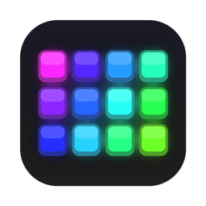

<p align="center"></p>

<h1 align="center">Keylight</h1>

<p align="center">Per-key RGB control for the <b>Keychron K8 Pro</b>: map images and videos onto your keys,<br>paint your own layouts and add on-click effects.</p>

---

Keylight is two things:

1. **Custom QMK firmware** (`firmware/`) that adds two lighting modes to the K8 Pro.
   - *Host direct* shows frames streamed from your Mac over USB.
   - *Saved layout* shows per-key colours stored on the keyboard, plus a click effect. It works over Bluetooth with no app running.
2. **A macOS app** (`app/`) that renders the lighting and gives you a UI to control it.

## Features

- **Base layers:** solid, painted per-key, gradient (animated), rainbow wave, breathe, **image** (fill / fit / stretch, optional scrolling) and **video / GIF** (looping).
- **Click effects:** flash, ripple, glow, cross, sparkle, trail, heatmap. Any colour or rainbow, with adjustable duration and size.
- **Save to keyboard:** stores the current look and the closest built-in click effect (flash / glow / ripple / cross) in the keyboard's EEPROM. It keeps working over Bluetooth and after a reboot.
- **Brightness and gamma** controls. The keyboard's own brightness keys still work.
- **Safe fallback:** if the app quits or the cable is unplugged, the keyboard takes its lighting back within 2.5 s.

## Supported hardware

**Keychron K8 Pro, ANSI, RGB backlight** (USB PID `0x0280`). The ISO, JIS and white-backlight versions use different LED layouts and aren't supported yet. Adding them is mostly a matter of the LED map in `app/layout.py` and building the matching keymap.

## Install

### 1. Flash the firmware (once)

Download `k8_pro_ansi_rgb_ledhost.bin` from the [latest release](../../releases/latest) into `dist/`, or build it yourself (see below). Then:

```bash
brew install dfu-util
firmware/flash.sh
```

The script walks you through bootloader mode: switch to **OFF**, hold **Esc**, switch to **Cable**.

> [!NOTE]
> Flashing resets your keymap and settings to Keychron defaults, like any firmware update. The layout is identical to stock, and VIA / Keychron Launcher keep working. To go back to Keychron's original firmware at any time, run `firmware/flash.sh --stock`. The STM32 bootloader lives in ROM, so the keyboard can always be recovered.

### 2. Install the app

Download `Keylight-macOS.zip` from the [latest release](../../releases/latest), unzip it and move **Keylight.app** to Applications. The build is Apple Silicon, macOS 12 or later.

The app is ad-hoc signed but not notarized, so macOS blocks it on first launch. Either right-click → **Open** → **Open**, or run:

```bash
xattr -dr com.apple.quarantine /Applications/Keylight.app
```

Video and GIF playback needs ffmpeg: `brew install ffmpeg`.

## Usage

- **Live control needs the USB cable.** Bluetooth has no channel for custom data. With the cable in, the mode switch can be on Cable or Bluetooth.
- In any mode except Paint, click a key in the preview to try the click effect.
- **Save to keyboard** to use your look over Bluetooth. Animated layers are saved as a still frame. Turn **Live control** back on to stream again.
- Quit Keylight before using VIA, since they share the same USB channel.
- Settings and uploaded media are stored in `~/Library/Application Support/Keylight`.

## Building from source

```bash
./run.sh                    # run from source in your browser at http://localhost:8787
packaging/build_app.sh      # build dist/Keylight.app and dist/Keylight-macOS.zip
firmware/build.sh           # build dist/k8_pro_ansi_rgb_ledhost.bin
```

`firmware/build.sh` fetches [Keychron's QMK fork](https://github.com/Keychron/qmk_firmware) at a pinned commit, applies `firmware/k8_pro.patch` (one small hook in the board code) and adds the `ledhost` keymap. It needs the ARM toolchain:

```bash
brew tap osx-cross/arm && brew install osx-cross/arm/arm-gcc-bin@13
```

## How it works

```
app/keylight.py   render loop (numpy) ── 10 × 32-byte raw HID packets/frame ──▶  K8 Pro firmware
                  ◀── key press events (row, col, LED) ─────────────────────────  (ledhost keymap)
app/static/       control UI (served locally, shown in a WKWebView window by app/mac_main.py)
```

The raw HID protocol is documented at the top of [`firmware/ledhost/ledhost.h`](firmware/ledhost/ledhost.h). It uses command byte `0xD0`, so it doesn't clash with VIA or Keychron's own commands. Frames are double-buffered on the keyboard, and the app re-sends at least once a second to keep direct mode alive.

## Disclaimer

This is an unofficial project, not affiliated with or endorsed by Keychron. Flashing custom firmware is at your own risk.

## License

[GPL-2.0-or-later](LICENSE), matching QMK.
